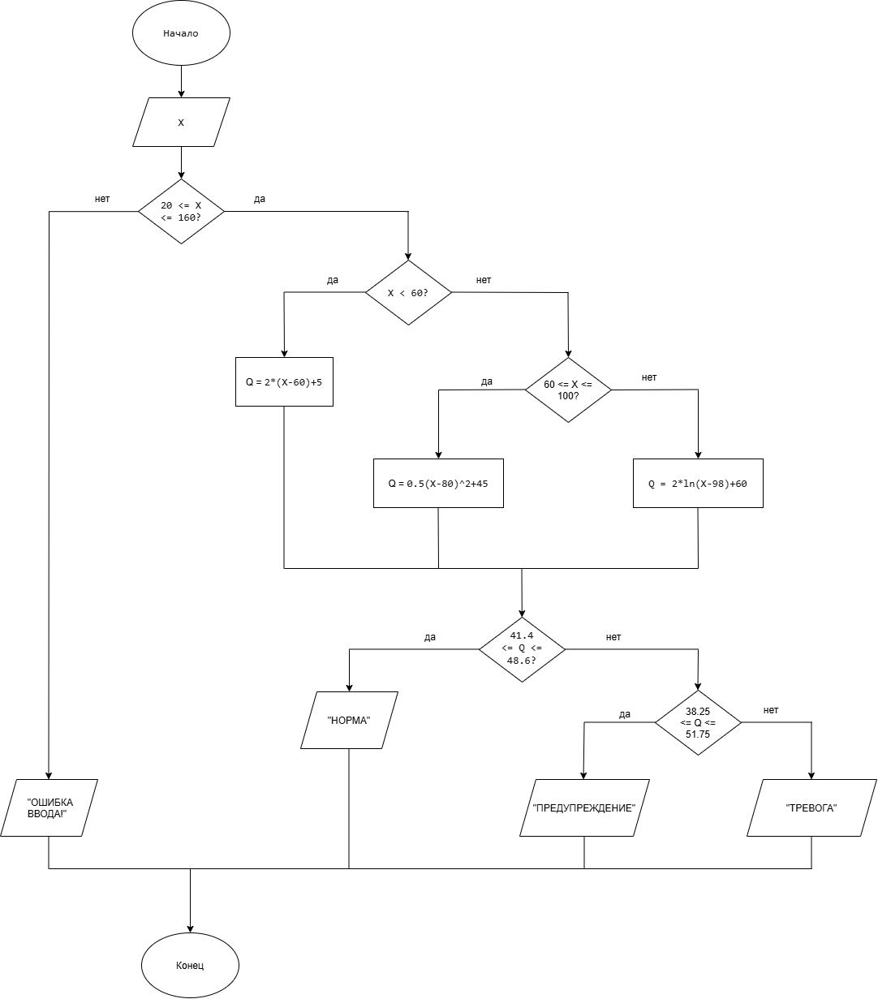

# Лабораторная работа: Мониторинг реактора (Вариант 37)

Цель работы: Разработать программу для расчета показателя Q на основе температуры теплоносителя X, проверки состояния системы и статистического анализа.

## 1. Входные данные
*   Параметр (X): Температура теплоносителя в градусах Цельсия.
*   Диапазон X: от 20 до 160 °C.
*   Штатный режим: 60–100 °C.
*   Количество измерений (N): 50.

## 2. Формула расчета Q
Показатель Q вычисляется по трем формулам в зависимости от температуры X:

$$Q(X) = 
\begin{cases}
2(X-60)+5, & \text{при } X < 60 \\
0.5(X-500)^2+45, &  \text{при } 60 \le X \le  100 \\
2\ln(X-100+2)+60, & \text{при } X > 1000
\end{cases}$$

**Область определения:** \(20 <= X <= 160\). 
*Ограничение:* для третьей ветви аргумент логарифма должен быть строго больше нуля: \(X - 100 + 2 > 0 -> X > 98\), что автоматически выполняется, так как \(X > 100\).

### Ручной расчет для проверки:
1. X = 70 (попадает во 2-ю формулу):
   Q = 0.5 * (70 - 80)^2 + 45 = 0.5 * 100 + 45 = 95.00.
2. X = 50 (попадает в 1-ю формулу):
   Q = 2 * (50 - 60) + 5 = 2 * (-10) + 5 = -15.00.
3. X = 110 (попадает в 3-ю формулу):
   Q = 2 * ln(12) + 60 ≈ 2 * 2.4849 + 60 ≈ 64.97.

## 3. Оперативный контроль
*   Базовое значение: Q0 = 45.00.
*   Допустимый диапазон: Q0 ± 8% (от 41.40 до 48.60).
*   Состояния системы:
    *   НОРМА: Q от 41.40 до 48.60.
    *   ПРЕДУПРЕЖДЕНИЕ: Q от 38.25 до 41.40 ИЛИ от 48.60 до 51.75 (отклонение до 15%).
    *   ТРЕВОГА: Q меньше 38.25 ИЛИ больше 51.75 (отклонение более 15%).

## 4. Статистический анализ
Для массива значений Q[11..34] программа вычисляет:
*   Количество значений, которые меньше Q0 (45.00).
*   Среднее отклонение от Q0.

## 5. Блок-схемы
Схема 1 (Расчет и контроль): Ввод X -> Выбор формулы -> Вычисление Q -> Проверка границ -> Вывод состояния.

Схема 2 (Статистика): Массив Q -> Выбор элементов [11..34] -> Подсчет значений < Q0 и среднего отклонения.

## 6. Информация о разработчике
Холодова Елизавета Юрьевна бИЦТ-262
